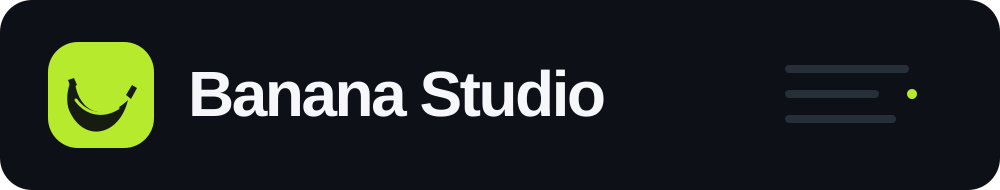
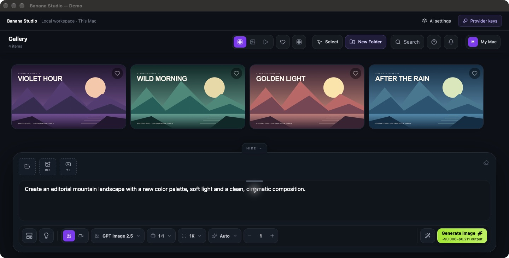
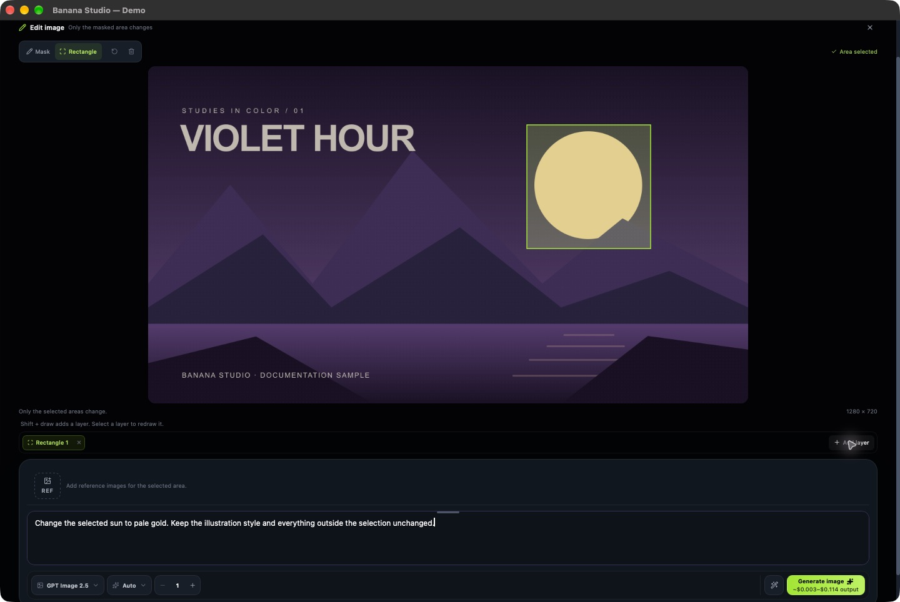

  

  <strong>Images, edits, YouTube thumbnails and video — with your own API keys.</strong> 
  Görsel, alan düzenleme, YouTube kapakları ve video — kendi API anahtarlarınla.

  <a href="#english">English</a> · <a href="#türkçe">Türkçe</a> ·
  <a href="https://github.com/orkunisitmak/banana-studio/releases/latest">Download / İndir</a> ·
  <a href="#self-hosting">Web setup / Web kurulumu</a>

  

Real interface, original demo artwork. No personal photos, user generations or real API keys. Gerçek arayüz, bu rehber için hazırlanmış örnek çizimler. Kişisel fotoğraf, kullanıcı üretimi veya gerçek API anahtarı içermez.

## English

**Banana Studio is an open source creative workspace for making images, editing selected areas, planning YouTube thumbnails and generating video.** Choose a model, add your own API key and keep your projects together in a gallery. You do not need to write code to use the Mac app.

The app is free under the [MIT license](LICENSE). AI services charge for their API usage; the app does not include model credits. Models run with external providers, so generation needs internet access.

### What can you make?

| Start with… | Make it with Banana Studio |
| --- | --- |
| A sentence or a few reference images | Generate a new image. Use `@` references to explain who or what belongs in the scene. |
| One part of an image you want to change | Draw a mask or rectangle, add selection layers and describe the edit. The final selection's outside pixels are preserved from the source. |
| A YouTube episode or a rough cover idea | Analyze a video, brainstorm distinct thumbnail concepts, enhance the prompt and generate variations. |
| A still image, text, audio or reference clips | Generate video with the controls supported by the selected video model. |
| A growing collection of work | Organize folders, favorites, references, people and templates; inspect generation details, recreate work and compare an edit with its source. |

### Pick your way in

| Your device | Available today | Start here |
| --- | --- | --- |
| Mac with Apple Silicon | Standalone app, macOS 13.5+ | [Download](https://github.com/orkunisitmak/banana-studio/releases/download/v0.1.0/Banana-Studio-0.1.0-macos-arm64.zip) · [Installation guide](docs/en/desktop.md) |
| Mac with Intel | Standalone app, macOS 13.5+ | [Download](https://github.com/orkunisitmak/banana-studio/releases/download/v0.1.0/Banana-Studio-0.1.0-macos-x64.zip) · [Installation guide](docs/en/desktop.md) |
| Windows | Web version in a browser; **no native Windows installer has been released** | Open your own or your team's deployed workspace. [Web setup](docs/en/deploy.md) |
| Other computers, phones and tablets | Web version in a browser | Open a deployed workspace; its owner manages access and provider keys. |

**Mac quick start:** download → unzip → move to Applications → open → **Provider keys** → add the key for your model → generate. The standalone app needs **no Supabase, Vercel, Google sign-in or separate Node installation**. The gallery stays on your Mac, and API keys stay in macOS Keychain. Keep the app open while jobs run; minimizing is fine. [First-open permissions, updates and backups →](docs/en/desktop.md)

### Which key do I need?

An API key is a private credential that lets the app use your account with an AI provider. Add only the providers you plan to use. These are the routes implemented **in this app**, not a list of every service offering each model.

| Model or feature | Provider used by this app | Key / server variable |
| --- | --- | --- |
| GPT Image 2.5 — image generation and area edits | OpenAI | `OPENAI_API_KEY` |
| Nano Banana Pro | fal.ai | `FAL_KEY` |
| Nano Banana 2.1 | fal.ai | `FAL_KEY` |
| Claude Opus 5.5 — Enhance, Brainstorm, variations and creative briefs | OpenRouter | `OPENROUTER_API_KEY` |
| GPT-6.1 Sol — the same text tasks | OpenAI | `OPENAI_API_KEY` |
| Gemini 3.8 Flash — text tasks and reading YouTube footage | Google Gemini | `GEMINI_API_KEY` |
| Seedance 2.0 / Seedance 2.5 Relaxed | EvoLink | `EVOLINK_API_KEY` |
| MiniMax H3 Max — text/image/reference to video, extend, lip sync and recast | fal.ai | `FAL_KEY` |
| YouTube channel/video lookup | Google YouTube Data API v3 | `YOUTUBE_API_KEY` |

The default image model is **GPT Image 2.5**; the default creative text model is **Opus 5.5 / Medium**. This pairing needs OpenAI + OpenRouter keys. Change the text model and thinking level in **AI settings**. Gemini keys alone do not enable the fal.ai image models. Full YouTube analysis needs the YouTube lookup key, Gemini for footage and the chosen creative model's provider. Some video-reference resizing also uses fal.ai. [Key creation links, examples and the complete feature map →](docs/en/models.md)

### Built for users and developers

The interface is **React + TypeScript + Vite**. The native Mac shell uses **AppKit + WKWebView**, bundles a **Node.js** server, saves to **SQLite + local files**, stores credentials in **Keychain** and updates through **Sparkle**. The web version uses **Vercel Functions / Queues / Cron** and **Supabase Postgres / Auth / private Storage**, with Google sign-in.

Selected prompts and references go to the provider handling the task. The desktop gallery has no built-in cloud sync; public folder links and account administration belong to the hosted web version. [Data boundaries](SECURITY.md) · [User guide](docs/en/guide.md) · [Developer setup and architecture](docs/en/development.md)

---

## Türkçe

**Banana Studio; görsel üretimi, seçili alan düzenleme, YouTube kapak fikirleri ve video üretimini aynı yerde toplayan açık kaynak bir yaratıcı çalışma alanı.** Modelini seç, kendi API anahtarını ekle, çalışmalarını galerinde biriktir. Mac uygulamasını kullanmak için kod yazman gerekmiyor.

Uygulama [MIT lisansıyla](LICENSE) ücretsizdir. Yapay zekâ servisleri API kullanımını ayrıca ücretlendirir; uygulama model kredisi içermez. Üretimler harici sağlayıcılarda çalıştığından internet bağlantısı gerekir.

### Neler yapabilirsin?

| Elinde ne var? | Banana Studio ile ne yapabilirsin? |
| --- | --- |
| Bir fikir veya birkaç referans görsel | Yeni bir görsel üret. `@` referanslarıyla sahnede hangi kişi veya nesnenin kullanılacağını anlat. |
| Görselde değiştirmek istediğin bir bölüm | Maske veya dikdörtgen çiz, seçim katmanları ekle ve değişikliği yaz. Son seçimin dışındaki pikseller kaynak görselden korunur. |
| Bir YouTube videosu veya kapak fikri | Videoyu analiz et, Brainstorm ile farklı kapak fikirleri oluştur, promptu geliştir ve varyasyonlar üret. |
| Metin, görsel, ses veya referans videolar | Seçtiğin video modelinin desteklediği kontrollerle video üret. |
| Biriken çalışmalar | Klasör, favori, referans, kişi ve şablonlarla düzenle; üretim bilgilerini incele, yeniden üret ve düzenlemeyi kaynağıyla karşılaştır. |

### Hangi cihazda nasıl kullanılır?

| Cihazın | Bugün sunulan sürüm | Buradan başla |
| --- | --- | --- |
| Apple Silicon işlemcili Mac | Bağımsız uygulama, macOS 13.5+ | [İndir](https://github.com/orkunisitmak/banana-studio/releases/download/v0.1.0/Banana-Studio-0.1.0-macos-arm64.zip) · [Kurulum rehberi](docs/tr/desktop.md) |
| Intel işlemcili Mac | Bağımsız uygulama, macOS 13.5+ | [İndir](https://github.com/orkunisitmak/banana-studio/releases/download/v0.1.0/Banana-Studio-0.1.0-macos-x64.zip) · [Kurulum rehberi](docs/tr/desktop.md) |
| Windows | Tarayıcı üzerinden web sürümü; **henüz yerel Windows kurulum paketi yayımlanmadı** | Kendi veya ekibinin kurduğu web adresini aç. [Web kurulumu](docs/tr/deploy.md) |
| Diğer bilgisayarlar, telefon ve tablet | Tarayıcı üzerinden web sürümü | Kurulmuş web adresini aç; erişimi ve servis anahtarlarını web alanının sahibi yönetir. |

**Mac'te hızlı başlangıç:** indir → zip'i aç → Applications / Uygulamalar'a taşı → aç → **Provider keys** → modelin anahtarını gir → üret. Bağımsız uygulamada **Supabase, Vercel, Google ile giriş veya ayrıca Node kurulumu gerekmez**. Galeri Mac'inde, API anahtarları macOS Anahtar Zinciri'nde tutulur. Üretim sürerken uygulamayı açık tut; pencereyi küçültebilirsin. [İlk açılış izinleri, güncelleme ve yedekleme →](docs/tr/desktop.md)

### Hangi model için hangi anahtar gerekiyor?

API anahtarı, uygulamanın ilgili yapay zekâ servisindeki hesabını kullanmasını sağlayan özel bir erişim bilgisidir. Yalnızca kullanacağın servisleri ekle. Tablo **bu uygulamanın kullandığı bağlantıları** gösterir; modelleri sunan tüm servislerin listesi değildir.

| Model veya özellik | Uygulamadaki sağlayıcı | Anahtar / sunucu değişkeni |
| --- | --- | --- |
| GPT Image 2.5 — görsel üretimi ve alan düzenleme | OpenAI | `OPENAI_API_KEY` |
| Nano Banana Pro | fal.ai | `FAL_KEY` |
| Nano Banana 2.1 | fal.ai | `FAL_KEY` |
| Claude Opus 5.5 — Enhance, Brainstorm, varyasyon ve yaratıcı brief | OpenRouter | `OPENROUTER_API_KEY` |
| GPT-6.1 Sol — aynı metin görevleri | OpenAI | `OPENAI_API_KEY` |
| Gemini 3.8 Flash — metin görevleri ve YouTube videosunu okuma | Google Gemini | `GEMINI_API_KEY` |
| Seedance 2.0 / Seedance 2.5 Relaxed | EvoLink | `EVOLINK_API_KEY` |
| MiniMax H3 Max — metin/görsel/referanstan video, uzatma, lip sync ve recast | fal.ai | `FAL_KEY` |
| YouTube kanal/video araması | Google YouTube Data API v3 | `YOUTUBE_API_KEY` |

Varsayılan görsel modeli **GPT Image 2.5**, yaratıcı metin modeli **Opus 5.5 / Medium**. Bu ikili için OpenAI + OpenRouter anahtarları gerekir. Metin modelini ve düşünme seviyesini **AI settings** üzerinden değiştirebilirsin. Gemini anahtarı tek başına fal.ai üzerinden çalışan görsel modellerini açmaz. Tam YouTube analizi için YouTube arama anahtarı, videoyu okumak için Gemini ve seçilen yaratıcı modelin sağlayıcısı gerekir. Bazı video referansı boyutlandırmaları ayrıca fal.ai kullanır. [Anahtar oluşturma bağlantıları, örnekler ve tam özellik tablosu →](docs/tr/models.md)

### Hangi sistemleri kullanıyor?

Arayüz **React + TypeScript + Vite** ile hazırlanır. Mac uygulaması **AppKit + WKWebView** içinde çalışır; kendi **Node.js** sunucusunu taşır, verileri **SQLite + yerel dosyalara**, anahtarları **Anahtar Zinciri'ne** kaydeder, **Sparkle** ile güncellenir. Web sürümü **Vercel Functions / Queues / Cron** ve **Supabase Postgres / Auth / özel Storage** kullanır; Google ile giriş yapılır.

İşlemde kullanılan prompt ve referanslar ilgili sağlayıcıya gönderilir. Masaüstü galerisi otomatik bulut senkronizasyonu yapmaz; herkese açık klasör bağlantıları ve hesap yönetimi kurulan web sürümüne aittir. [Veri ve güvenlik sınırları](SECURITY.md) · [Kullanım rehberi](docs/tr/guide.md) · [Geliştirici kurulumu ve mimari](docs/tr/development.md)

---

## Put it on the web / Web'e kur

**English:** want a browser workspace for Windows, Mac and your team? Fork the repository, create your own Supabase project, deploy your fork to Vercel, add the Supabase configuration and your provider keys as server environment variables, configure Google sign-in and activate the first administrator. The checked-in one-minute Cron schedule requires a Vercel plan that supports it; uploading just the frontend is insufficient. The tutorial includes a browser-only SQL Editor route, a variable table, checkpoints and troubleshooting.

**[Open the step-by-step web deployment tutorial →](docs/en/deploy.md)**

**Türkçe:** Windows, Mac ve ekibin için tarayıcıdan açılan bir çalışma alanı mı istiyorsun? Repoyu kendi GitHub hesabına kopyala, kendi Supabase projeni oluştur, Vercel'e deploy et, Supabase bilgilerini ve servis anahtarlarını sunucu ortam değişkenlerine gir, Google girişini ayarla ve ilk yöneticiyi etkinleştir. Repodaki dakikalık Cron için bunu destekleyen Vercel planı gerekir; yalnızca arayüz dosyalarını yüklemek yeterli değildir. Rehberde terminal gerektirmeyen SQL Editor yolu, değişken tablosu, her aşamanın kontrolü ve hata çözümleri var.

**[Adım adım web kurulum rehberini aç →](docs/tr/deploy.md)**

<a href="LICENSE">MIT</a> · <a href="SECURITY.md">Security</a> · <a href="docs/RELEASING.md">Release procedure</a> · <a href="docs/THIRD_PARTY_NOTICES.md">Third-party notices</a>

